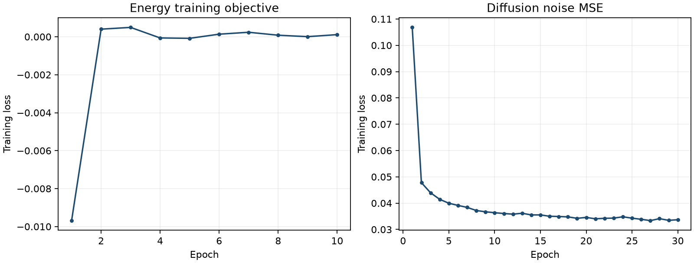
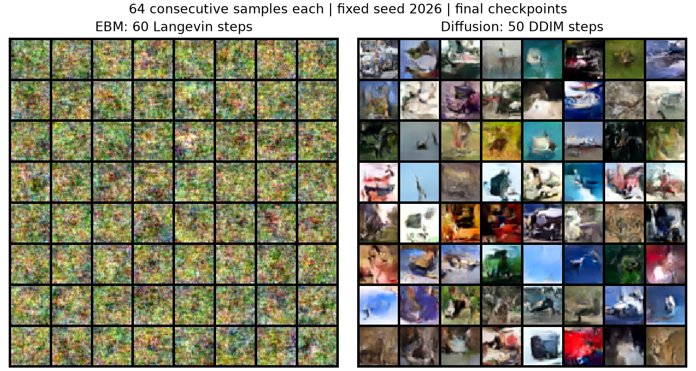

# Actual training report

Recorded November 1, 2026. Both runs used every one of the 50,000 training images per epoch.

|Model|Epochs|Optimizer steps|Parameters|Elapsed seconds|Final training loss|
|---|---:|---:|---:|---:|---:|
|ebm|10|3910|275265|613.9|0.00011275|
|diffusion|30|23460|1528803|1055.0|0.03370077|

Hardware: NVIDIA GeForce RTX 3070. Python 3.12.13, PyTorch 2.11.0+cu128. The two jobs overlapped; elapsed times are per process, not exclusive GPU benchmarks.

Final checkpoints were chosen at the predeclared final epoch. The 1,024-image test diagnostic below was run afterward and did not choose or tune the checkpoints. Test images were not training data.

Diffusion epsilon MSE: 0.03387479; zero-predictor MSE: 0.99939806 (seed 8761, uniform random timesteps).
EBM initial mean energy: 5.37177086; after 60 steps: 0.03443558; mean squared pixel change: 0.23786573.

These are mechanism diagnostics, not image-quality scores. EBM samples remain mostly noisy coarse textures. Diffusion samples show limited recognizable low-resolution structures but artifacts remain. No FID or convergence claim is made.

## Checkpoint hashes

- `cifar10_cnn.pt`: `9f4e454bfdef8850eebdc293e6811ce6fed77dc645f7f0d49030c690b9289b95`
- `cifar10_diffusion.pt`: `885cb28faafe8c39ec4f23e9a8a93dd1c8b9ba51538575d29269c44e2abdfd34`
- `cifar10_ebm.pt`: `76fdb073171848dd6fdd7d96b17776cc64ee08d868f9cb9a9f3ead1fd45a343d`
- `mnist_gan_generator.pt`: `df32531071223a2e4f2098ad452f360282b5f69878f6baf1db4a201b4fbd16d1`
